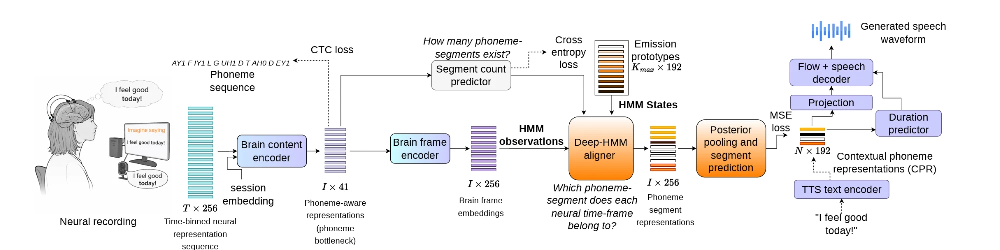

# Brain2Speech-Net

**Fast and Intelligible Brain-to-Speech Synthesis Without Text Decoding**

Shreeram Suresh Chandra, Zexin Cai, Yu Tsao, Simon King, Berrak Sisman

[[Paper (arXiv:2609.04455)]](https://arxiv.org/abs/2609.04455) · [[Project page & audio samples]](https://b2s-lang.github.io/)

Brain2Speech-Net turns intracortical recordings of attempted speech into a speech waveform in a
**single pass**, with no intermediate text decoding. A differentiable phoneme bottleneck and a
lightweight deep-HMM aligner map long neural recordings onto the contextual phoneme
representations (CPRs) of a pretrained VITS text-to-speech model, whose decoder then produces the
waveform. It is the only system in our comparison that produces intelligible speech while generating
faster than real time.



*Solid lines: data flow during training and inference. Dotted lines: training only.*

---

## Contents

- [How it works](#how-it-works)
- [Results](#results)
- [Installation](#installation)
- [Data and pretrained models](#data-and-pretrained-models)
- [Quick start: speech from neural recordings](#quick-start-speech-from-neural-recordings)
  - [Faster inference on a GPU (CUDA graphs)](#faster-inference-on-a-gpu-cuda-graphs)
- [Reproducing the paper](#reproducing-the-paper)
- [Training from scratch](#training-from-scratch)
- [Repository layout](#repository-layout)
- [Reproducibility notes](#reproducibility-notes)
- [Citation](#citation)
- [License and acknowledgements](#license-and-acknowledgements)

## How it works

| Stage | What it does | Code |
|---|---|---|
| **Brain content encoder** | 5-layer bidirectional GRU over windowed neural features (256 channels, 20 ms bins, kernel 32, stride 2) with a learned per-session input layer (the *session embedding*). Emits frame-level phoneme logits n_i ∈ R⁴¹: the phoneme bottleneck. | [`content_encoder.py`](brain2speech_net/content_encoder.py) |
| **Phase 1** | Pre-train the encoder with CTC on the phoneme sequence of each prompt. | [`scripts/train_phase1.py`](scripts/train_phase1.py) |
| **Brain frame encoder** | Linear layer + 3 residual MLP blocks: n_i → e_i ∈ R²⁵⁶ (the HMM observations). | [`aligner.py`](brain2speech_net/aligner.py) |
| **Deep-HMM aligner** | Left-to-right, no-skip HMM whose states are CPR *segment positions*. Emissions log E_i(k) = −‖A e_i − c_k‖², with c_k = W_tgt z_k during training and learned emission prototypes c_k = P[k] at inference. Transitions (stay / advance / stop) come from a neural network h_θ(e_i, v_k). Forward–backward gives soft alignments γ_{i,k}. | [`aligner.py`](brain2speech_net/aligner.py) |
| **Posterior pooling and segment prediction (PPSP)** | γ-weighted pooling of the frame embeddings into N segments, then a segment head, a 4-layer Transformer and a residual refinement MLP predict the CPRs ẑ. | [`aligner.py`](brain2speech_net/aligner.py) |
| **Segment count predictor** | Predicts N (cross-entropy) from an attention-pooled summary of the phoneme-aware frames; sets the number of HMM states at inference. | [`aligner.py`](brain2speech_net/aligner.py) |
| **Phase 2** | Train aligner + PPSP with the CPR MSE loss and fine-tune the encoder (lr 1e-5) with an auxiliary CTC loss (λ = 0.3). The CTC and segment-count losses are optimised independently of the alignment objective. | [`scripts/train_phase2.py`](scripts/train_phase2.py) |
| **Frozen VITS** | Its text encoder provides the CPR targets z ∈ R^{192×N} during training. At inference its projection, duration predictor, flow and decoder turn predicted CPRs into a 22.05 kHz waveform. | [`tts.py`](brain2speech_net/tts.py) |

At inference the path is **neural features → encoder → deep-HMM/PPSP → CPRs → VITS → waveform**. No transcript,
language model or text is involved.

## Results

Open set: the official test split of Willett et al. (2023), 880 utterances never seen in training
(Table 1 of the paper). Text WER applies to the cascades only. WER and PER are fractions, MCD is in dB.

| Model | Text WER ↓ | PER ↓ | WER ↓ | MCD ↓ | RTF ↓ |
|---|---|---|---|---|---|
| NTS-Cascade (5-gram) | 0.197 | 0.209 | 0.229 | 4.967 | 1.846 |
| NTS-Cascade (5-gram + LLM) | 0.172 | 0.188 | 0.206 | 4.894 | 1.962 |
| DSU baseline | — | 0.785 | 1.054 | 6.181 | 0.060 |
| **Brain2Speech-Net** | — | **0.373** | **0.472** | **5.522** | **0.532** |

Ground-truth (pseudo-target) speech: WER 0.025.

Training fit: 880 utterances of the training split, sampled uniformly across sessions (Table 2 of the
paper; the exact list is [`splits/seen880.tsv`](splits/seen880.tsv)). 866 of them were used for training
and 14 fall in the 80-utterance validation set.

| Model | Text WER ↓ | PER ↓ | WER ↓ | MCD ↓ | RTF ↓ |
|---|---|---|---|---|---|
| NTS-Cascade (5-gram) | 0.037 | 0.078 | 0.059 | 4.415 | 1.664 |
| NTS-Cascade (5-gram + LLM) | 0.021 | 0.069 | 0.042 | 4.363 | 1.714 |
| DSU baseline | — | 0.758 | 1.011 | 6.004 | 0.056 |
| **Brain2Speech-Net** | — | **0.109** | **0.068** | **4.632** | **0.504** |

Ground-truth (pseudo-target) speech: WER 0.021.

Listening test (20 listeners, 20 open-set utterances per system, intelligibility on a 1–5 scale):
NTS-Cascade (5-gram) 3.85 ± 0.11, NTS-Cascade (5-gram + LLM) 3.90 ± 0.11, DSU baseline 1.57 ± 0.08,
**Brain2Speech-Net 3.34 ± 0.11**.

This repository contains Brain2Speech-Net. The cascaded and DSU baselines are described in the paper
and are not part of this release.

## Installation

Requires Python ≥ 3.9 and PyTorch ≥ 1.13 (a CUDA GPU is recommended for training; inference runs in real time on CPU).

```bash
git clone https://github.com/Kodhandarama/Brain2Speech-Net.git
cd Brain2Speech-Net
pip install -r requirements.txt          # core + text processing
pip install -r requirements-eval.txt     # only needed to compute WER / PER / MCD
```

Data preparation (CPR targets and reference speech) also needs the **espeak-ng** system package,
for example `brew install espeak-ng` or `sudo apt-get install espeak-ng`. Speech synthesis from
neural recordings does not need espeak-ng.

Check the installation (CPU, random weights, about 10 s):

```bash
python -m pytest tests
```

## Data and pretrained models

| What | Where | Put it in |
|---|---|---|
| Intracortical dataset of Willett et al. (2023): `competitionData.tar.gz` (3.7 GB) | [Dryad, doi:10.5061/dryad.x69p8czpq](https://datadryad.org/stash/dataset/doi:10.5061/dryad.x69p8czpq) | anywhere, e.g. `raw/competitionData/` |
| Pretrained VITS (LJSpeech): `pretrained_ljs.pth` | [VITS pretrained models](https://drive.google.com/drive/folders/1ksarh-cJf3F5eKJjLVWY0X1j1qsQqiS2?usp=sharing) from [jaywalnut310/vits](https://github.com/jaywalnut310/vits) | `pretrained/pretrained_ljs.pth` |
| Pretrained Brain2Speech-Net: `brain2speech_net_t12.pt` (559 MB, the model behind the reported numbers) | [Release v2.0](../../releases/tag/v2.0) of this repository (same weights as v1.0) | `pretrained/brain2speech_net_t12.pt` |

SHA-256 of `brain2speech_net_t12.pt`: `ef9ef00072089d1bdeb9e5cbce20d6b86179b84210d56884c552334191653974`.
With the GitHub CLI: `gh release download v2.0 -R Kodhandarama/Brain2Speech-Net -D pretrained`.

Then build the model inputs:

```bash
tar -xzf competitionData.tar.gz -C raw/
python scripts/prepare_data.py \
    --competition_data raw/competitionData \
    --vits_checkpoint pretrained/pretrained_ljs.pth \
    --out_dir data --references
```

This writes:

- `data/train.npz` (8,800 utterances) and `data/test.npz` (880 utterances). Each has, per utterance, the
  256-channel neural features (area 6v threshold crossings + spike-band power, z-scored per recording
  block), session index, prompt, phoneme labels (39 ARPAbet phonemes + `SIL`) and the VITS CPR targets.
- `data/reference_wavs/{test,seen880}/`: VITS speech synthesised from the prompts. The participant
  cannot speak, so this pseudo-target speech is the reference for PER and MCD.

## Quick start: speech from neural recordings

```bash
python scripts/synthesize.py \
    --checkpoint pretrained/brain2speech_net_t12.pt \
    --vits_checkpoint pretrained/pretrained_ljs.pth \
    --data data/test.npz --out_dir outputs/open_set
```

This writes one wav per utterance (`<session>_<trial>.wav`), a `manifest.tsv` with the prompt, predicted
segment count and per-utterance real-time factor, and `synthesis_summary.json` with the mean RTF.

From Python:

```python
from brain2speech_net import Brain2SpeechNet
from brain2speech_net.data import Brain2SpeechDataset
from brain2speech_net.tts import PretrainedVITS, save_wav

model = Brain2SpeechNet.from_pretrained("pretrained/brain2speech_net_t12.pt")
vits = PretrainedVITS("pretrained/pretrained_ljs.pth")

utt = Brain2SpeechDataset("data/test.npz", require_cpr=False)[0]
cpr = model.predict_cpr(utt["neural"], utt["day_idx"])   # (192, N) CPRs, no text involved
wav = vits.cpr_to_speech(cpr)                            # float32 waveform at 22.05 kHz
save_wav("example.wav", wav, vits.sampling_rate)
print("prompt was:", utt["transcript"])
```

`neural` is a `(T, 256)` array of 20 ms bins and `day_idx` the recording-session index (0–23).

### Faster inference on a GPU (CUDA graphs)

```bash
python scripts/synthesize.py --checkpoint pretrained/brain2speech_net_t12.pt \
    --vits_checkpoint pretrained/pretrained_ljs.pth --data data/test.npz --out_dir outputs/open_set \
    --device cuda --cuda_graphs
```

On a GPU, one utterance at a time, the deep-HMM aligner is limited by kernel launches rather than
arithmetic: its forward–backward recursion issues about 10,000 tiny kernels per utterance. `--cuda_graphs`
captures the aligner once per input-size bucket (16 encoder frames × 32 segments) and replays it
([`brain2speech_net/cuda_graphs.py`](brain2speech_net/cuda_graphs.py); from Python,
`GraphedBrain2Speech(model).predict_cpr(...)`). Inputs are zero-padded to the bucket, which the aligner
already masks, so outputs do not change; the brain content encoder and VITS run as usual. Capturing the
graphs takes 15–25 s once per run; it is excluded from the RTF and reported in `synthesis_summary.json`.

RTF on one NVIDIA H100, float32, one utterance at a time, all 880 utterances of each set (mean / median):

| System | Open set | Training fit |
|---|---|---|
| **Brain2Speech-Net, CUDA graphs** | **0.020** / 0.019 | **0.020** / 0.019 |
| Brain2Speech-Net, without CUDA graphs | 0.036 / 0.034 | 0.036 / 0.034 |
| NTS-Cascade (5-gram) | 0.038 / 0.032 | 0.025 / 0.023 |

- **Same outputs.** Against release v1.0 (all 1,760 utterances, NVIDIA A100): identical predicted segment
  counts for every utterance, identical audio length for 1,756 (the other four differ by one frame), and a
  median largest per-sample difference of 1 LSB of 16-bit audio. Whisper WER is 0.4456 vs 0.4460 (open set)
  and 0.0683 vs 0.0685 (training fit).
- **The cascade** was timed the same way (neural input to waveform, warm-up excluded): Willett et al.'s GRU
  phoneme decoder and VITS on the GPU, WFST decoding (beam 18) and phonemisation on the CPU, where the
  decoder runs. WFST decoding dominates and grows with how confusable the input is (46 ms per utterance on
  the open set, 21 ms on the training fit); the GRU takes 6 ms and VITS 24 ms. In this run its text WER was
  0.191 / 0.014 and its speech WER 0.205 / 0.032 (open set / training fit; paper: 0.197 / 0.037 and
  0.229 / 0.059). The cascade is not part of this repository.
- The CPU RTFs in the results tables are unchanged: CUDA graphs only apply on a GPU.

## Reproducing the paper

**Table 1, open set** (official test split):

```bash
python scripts/synthesize.py --checkpoint pretrained/brain2speech_net_t12.pt \
    --vits_checkpoint pretrained/pretrained_ljs.pth --data data/test.npz --out_dir outputs/open_set
python scripts/evaluate.py --generated outputs/open_set --references data/reference_wavs/test
```

**Table 2, training fit** (880 seen utterances):

```bash
python scripts/synthesize.py --checkpoint pretrained/brain2speech_net_t12.pt \
    --vits_checkpoint pretrained/pretrained_ljs.pth \
    --data data/train.npz --subset splits/seen880.tsv --out_dir outputs/seen880
python scripts/evaluate.py --generated outputs/seen880 --references data/reference_wavs/seen880
```

**Ground-truth speech reference** row:

```bash
python scripts/evaluate.py --generated data/reference_wavs/test --metrics wer
```

`evaluate.py` writes `evaluation.json` (corpus WER, mean PER, mean MCD, mean RTF) and a per-utterance TSV
into the generated folder. The metrics follow the paper:

- **WER**: Whisper-medium transcripts; lowercase, punctuation removed; total word errors / total reference words.
- **PER**: phonemes from wav2vec 2.0-Large-LV60 fine-tuned for phoneme recognition
  (`excalibur12/wav2vec2-large-lv60_phoneme-timit_english_timit-4k_simplified`), decoded from the generated
  and the reference speech; mean over utterances.
- **MCD**: WORLD mel-cepstra (order 39, α = 0.466, 5 ms shift), silent frames removed, DTW-aligned; mean over utterances.
- **RTF**: time from neural input to waveform divided by the audio duration, single utterance at a time
  on CPU. Absolute RTF depends on the machine. For GPU numbers see
  [Faster inference on a GPU](#faster-inference-on-a-gpu-cuda-graphs).

## Training from scratch

Both phases read YAML configs whose defaults are the paper's hyperparameters. Any entry can be overridden
on the command line as `key.subkey=value`.

**Phase 1: brain content encoder (CTC).**

```bash
python scripts/train_phase1.py --config configs/phase1_content_encoder.yaml
# -> checkpoints/phase1/content_encoder.pt
```

**Phase 2: deep-HMM alignment + encoder fine-tuning.**

```bash
python scripts/train_phase2.py --config configs/phase2_brain2speech_net.yaml
# -> checkpoints/phase2/last.pt (every epoch), epoch_XXXX.pt (every 5 epochs), brain2speech_net.pt (final)
```

The configs reproduce the training run behind the reported numbers. Main settings
([`configs/phase2_brain2speech_net.yaml`](configs/phase2_brain2speech_net.yaml)): Adam, batch size 32,
peak learning rate 1e-3 (1e-5 for the encoder), 500 warm-up steps followed by cosine decay over 1000
scheduled epochs, λ_CTC = 0.3, emission prototypes P ∈ R^{512×192} initialised by k-means (10 restarts)
on projected training CPRs and re-clustered every 5 epochs. A seed-42 permutation of the 8,800
training utterances gives 8,720 for training and 80 for validation (teacher-forced CPR loss, monitoring
only). The released model is the checkpoint after **285** epochs, where that run stopped; with these
configs it corresponds to `checkpoints/phase2/epoch_0285.pt`.

Useful options:

```bash
# resume an interrupted run
python scripts/train_phase2.py --config configs/phase2_brain2speech_net.yaml --resume checkpoints/phase2/last.pt
# log to Weights & Biases
python scripts/train_phase2.py --config configs/phase2_brain2speech_net.yaml --wandb_project brain2speech-net
# k-means over the ~0.6 M training CPR segments is the slowest part of re-clustering; subsample it if needed
python scripts/train_phase2.py --config configs/phase2_brain2speech_net.yaml prototypes.max_points=200000
```

Checkpoints produced by our original research code (encoder directory with `args` + `modelWeights`, and an
aligner `.pt`) can be packaged into the single-file format used here:

```bash
python scripts/convert_checkpoint.py --encoder_dir <FT_GRU dir> --aligner_checkpoint <last.pt> \
    --out pretrained/brain2speech_net_t12.pt
```

## Repository layout

```
Brain2Speech-Net/
├── brain2speech_net/
│   ├── content_encoder.py   brain content encoder (session-conditioned GRU, phoneme logits)
│   ├── aligner.py           brain frame encoder, deep-HMM aligner, PPSP, segment count predictor,
│   │                        losses, k-means emission prototypes
│   ├── model.py             Brain2SpeechNet: encoder + aligner + CTC head, save / load / predict_cpr
│   ├── cuda_graphs.py       GPU inference with the aligner replayed as CUDA graphs
│   ├── tts.py               frozen VITS: text -> CPR targets, CPR -> speech, pseudo-target speech
│   ├── data.py              Willett competitionData loader, prepared-data dataset, batching
│   ├── phonemes.py          phoneme inventory and grapheme-to-phoneme labels
│   ├── metrics.py           WER / PER / MCD
│   ├── config.py            YAML configs with command-line overrides
│   └── vits/                minimal inference subset of VITS (MIT)
├── configs/                 Phase 1 and Phase 2 hyperparameters
├── scripts/                 prepare_data, train_phase1, train_phase2, synthesize, evaluate, convert_checkpoint
├── splits/seen880.tsv       the 880 training utterances of the training-fit evaluation
├── tests/                   CPU smoke tests
└── assets/                  figure
```

## Reproducibility notes

- **Released model vs. reported numbers.** With this code, the released checkpoint regenerates the audio
  the paper was evaluated on: predicted segment counts are identical, and waveforms match to a correlation
  of at least 0.995 (open set) and 1.000 (training-fit set) on the utterances we compared. Remaining
  differences are floating-point (hardware and PyTorch version).
- **Settings that differ from the paper text.** Configs and the released model follow the run behind the
  reported numbers: λ_CTC = 0.3 (the paper states 0.1), and 80 training utterances held out for validation.
- **Text processing versions.** CPR targets and reference speech depend on the grapheme-to-phoneme
  stack. Our environment had Python 3.9, PyTorch 1.13.1, g2p-en 2.1.0, and phonemizer 2.2.1 alongside
  phonemizer-fork 3.3.2. With
  espeak-ng 1.52.0, about one utterance in six gets a CPR sequence one or two symbols different from ours
  (for example *"Most young rise early every morning."*); the remaining CPRs match to within 1e-5.
  Generating speech from neural recordings with a trained model does not use espeak-ng.
- **Phase 1 checkpoint selection** follows the `neural_seq_decoder` recipe of Willett et al. and keeps the
  encoder with the lowest greedy phoneme error on `data.val` (the official test split by default). Point
  `data.val` to a separate file to select on held-out training data instead.
- **GPU evaluation.** Generating both sets with this code on an NVIDIA A100 in float32 gives Whisper WER
  0.446 on the open set and 0.068 on the training fit (paper: 0.472 and 0.068).
- **Inference settings.** The segment count is predicted, emissions use the learned prototypes, and VITS
  runs with `noise_scale = noise_scale_w = 0`, so synthesis is deterministic. `synthesize.py --oracle_length`
  uses the true segment count instead (diagnostic only; it needs the CPR targets).
- **Frame lengths.** As in the original training code, the HMM uses ⌊(T − 32) / 2⌋ valid encoder frames
  during training (the CTC length convention) and all encoder output frames at inference.

## Citation

```bibtex
@article{sureshchandra2026brain2speechnet,
  title   = {Brain2Speech-Net: Fast and Intelligible Brain-to-Speech Synthesis Without Text Decoding},
  author  = {Suresh Chandra, Shreeram and Cai, Zexin and Tsao, Yu and King, Simon and Sisman, Berrak},
  journal = {arXiv preprint arXiv:2609.04455},
  year    = {2026}
}
```

Please also cite the dataset:

```bibtex
@article{willett2023high,
  title   = {A high-performance speech neuroprosthesis},
  author  = {Willett, Francis R. and Kunz, Erin M. and Fan, Chaofei and Avansino, Donald T. and Wilson, Guy H. and
             Choi, Eun Young and Kamdar, Foram and Glasser, Matthew F. and Hochberg, Leigh R. and
             Druckmann, Shaul and Shenoy, Krishna V. and Henderson, Jaimie M.},
  journal = {Nature},
  volume  = {620},
  number  = {7976},
  pages   = {1031--1036},
  year    = {2023}
}
```

## License and acknowledgements

The Brain2Speech-Net code and pretrained model are released under the [MIT License](LICENSE): anyone
may use, copy, modify and distribute them for any purpose, commercial or not, as long as the copyright
and license notice are kept in copies.

- `brain2speech_net/vits/` is a minimal inference subset of [VITS](https://github.com/jaywalnut310/vits)
  by Jaehyeon Kim, also under the MIT License (see [`brain2speech_net/vits/LICENSE`](brain2speech_net/vits/LICENSE)).
  Its imports were made package-relative and two imports made lazy; the model code is unchanged.
- The brain content encoder and its Phase 1 recipe follow the GRU baseline of Willett et al. (2023)
  and its PyTorch port [`neural_seq_decoder`](https://github.com/cffan/neural_seq_decoder).
- The intracortical data were released by Willett et al. (2023) on
  [Dryad](https://datadryad.org/stash/dataset/doi:10.5061/dryad.x69p8czpq) and are not redistributed here.
